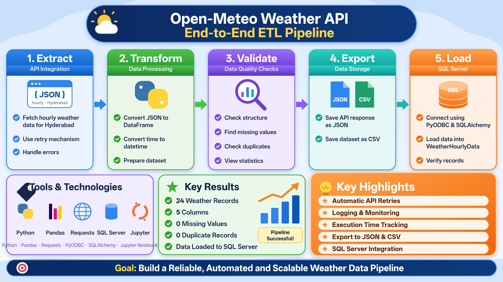

# 🌦️ Weather Data ETL Pipeline – From API to Database

## 📌 Project Overview

This project demonstrates an end-to-end weather data pipeline built using Python and API integration.

The pipeline extracts weather forecast data from the Open-Meteo API, transforms the JSON response into a structured dataset, performs data quality checks, and loads the processed data into a target database.

It follows the ETL process: **Extract → Transform → Validate → Load**.

## 🖼️ Project Architecture

### Weather Data ETL Pipeline – From API to Database

This architecture illustrates the complete project workflow, from API data extraction and Python-based processing to database storage.

**Image filename:** `weather-data-etl-pipeline.png.jpeg`

## 🎯 Project Objectives

- Retrieve weather forecast data through API integration.
- Convert JSON responses into structured datasets.
- Process and prepare data using Python and Pandas.
- Perform data quality checks.
- Identify missing values and duplicate records.
- Load processed data into a target database.
- Export datasets into CSV and JSON formats.

## 🛠️ Tools & Technologies

- **Programming Language:** Python
- **Data Processing:** Pandas
- **API Integration:** Requests
- **Data Source:** Open-Meteo API
- **Data Formats:** JSON, CSV
- **Database:** SQL Database
- **Development Environment:** Google Colab

## 🔄 ETL Workflow

### 1. Extract – API Integration

- Connected to the Open-Meteo Weather API.
- Retrieved hourly weather forecast data for Hyderabad, India.
- Used latitude and longitude coordinates to specify the location.
- Extracted temperature, relative humidity, wind speed, and precipitation data.

### 2. Transform – Data Processing

- Converted the API response into a Pandas DataFrame.
- Structured the extracted information into rows and columns.
- Converted the time column into datetime format.
- Prepared the dataset for validation and storage.

### 3. Validate – Data Quality Checks

Performed data quality checks using Pandas:

- Inspected dataset information and column data types.
- Checked for missing values.
- Identified duplicate records.
- Generated descriptive statistics.
- Verified dataset completeness.

### 4. Load – Database Integration

- Loaded the processed weather dataset into the target database.
- Stored structured weather records for further querying and analysis.
- Exported the original API response into JSON format.
- Exported the processed dataset into CSV format.

## 📊 Dataset Overview

The project collected hourly weather forecast data for Hyderabad, India.

| Attribute | Details |
|---|---|
| Location | Hyderabad, India |
| Latitude | 17.3850 |
| Longitude | 78.4867 |
| Forecast Period | 1 Day |
| Total Records | 24 |
| Total Columns | 5 |

### Dataset Columns

| Column | Description |
|---|---|
| time | Weather timestamp |
| temperature_2m | Temperature at 2 metres |
| relative_humidity_2m | Relative humidity |
| wind_speed_10m | Wind speed at 10 metres |
| precipitation | Precipitation amount |

## 📈 Key Results

The extracted dataset contained:

- **24** hourly weather records.
- **5** structured columns.
- **25.93°C** average temperature.
- **31.1°C** maximum temperature.
- **73.33%** average relative humidity.
- **11.3 km/h** maximum wind speed.
- **0.3 mm** maximum hourly precipitation.
- **0** missing values.
- **0** duplicate records.

## 📁 Project Files

| File | Description |
|---|---|
| Hyderabad_Weather_API_Data_Pipeline.ipynb | Complete Python implementation |
| api_response.json | Original API response |
| hyderabad_weather_data.csv | Processed weather dataset |
| weather-data-etl-pipeline.png.jpeg | Project architecture visual |

## 🚀 Future Enhancements

- Automate scheduled API data extraction.
- Extend data collection to multiple locations.
- Integrate additional weather APIs.
- Develop interactive Power BI dashboards.
- Perform weather trend analysis.

## 👩‍💻 Author

**Shaik Asmatha**

Aspiring Data Analyst | Data Science Graduate

- **GitHub:** https://github.com/As-01-Asma
- **Portfolio:** https://celadon-tartufo-fc56fc.netlify.app

---
